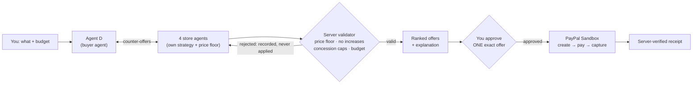
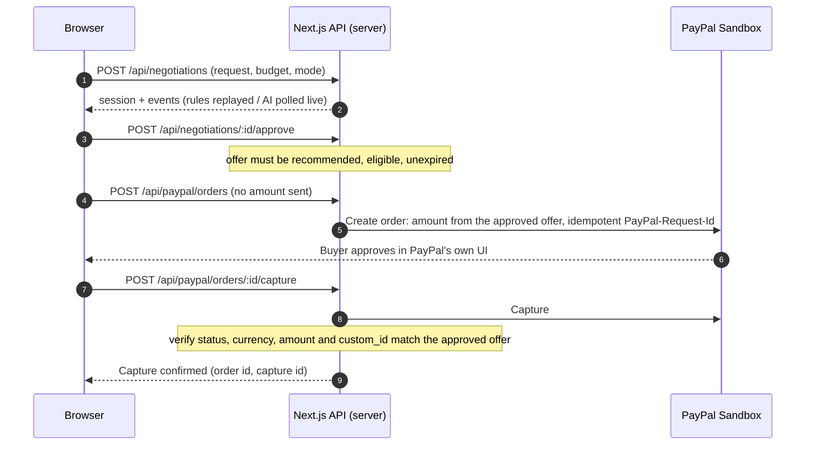
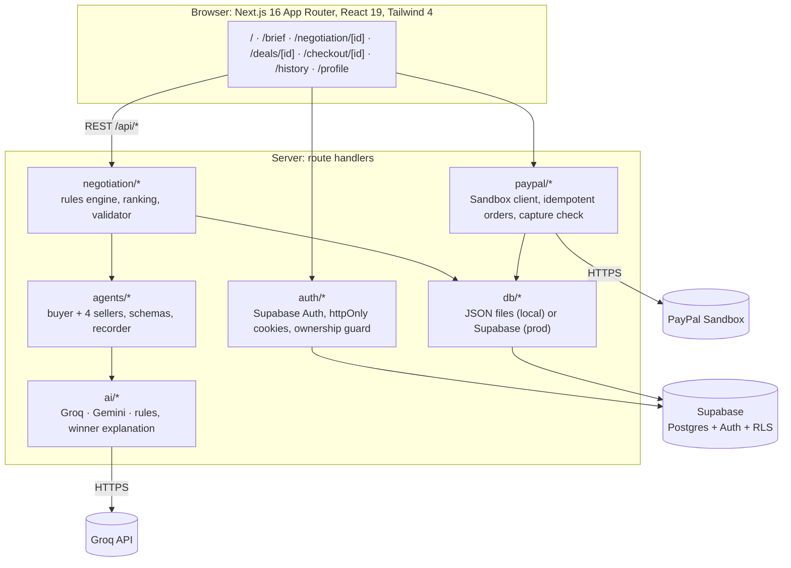

<p align="center">
  
</p>

<h1 align="center">AgentD</h1>

<p align="center"><strong>Agent D, it always gets you the best deal.</strong><br/>
An AI buyer agent that negotiates with four store agents, brings back competing offers, and pays with <b>PayPal Sandbox</b> only after you approve one exact offer.</p>

<p align="center">
  <a href="https://paypal-ai-hackathon-2026-pied.vercel.app/"><b>Live demo</b></a> ·
  <a href="https://github.com/mirsinghh/PayPal-AI-Hackathon-2026">Repository</a> ·
  <a href="#run-it-locally">Run locally</a> ·
  <a href="LICENSE">MIT license</a>
</p>

> **Everything is a simulation.** The four stores (Brisa Outlet, Zefiro Express, Atelier Norden, Korvan Direct) are fictional; their prices, stock and terms are invented. Nothing ships and no real money moves: the server refuses any PayPal environment other than **Sandbox**. "Best deal" means best among those four simulated stores, not the whole market.

## The idea in one line

**AI proposes, the server validates, a human decides.**



## What you can do

1. Describe a purchase and a budget in plain words; Agent D reads it back (product, budget, priority, preferences).
2. Pick **how the stores reply** (see below).
3. Watch the **Negotiation Room**: per-store chat threads, price cards, and a panel explaining how Agent D is deciding.
4. Compare offers in the **Decision Lab**, read what Agent D achieved (opening vs final price, savings under budget, trade-offs against the runner-up), and approve one.
5. Pay with **PayPal Sandbox**. The page ends on **Capture confirmed** only after the server has verified the capture.
6. Sign in (optional, Supabase Auth) to keep **History / Profile**: requests, analyses, negotiations, payments, savings. Guests can do everything except keep cross-device history.

### Two ways for the stores to reply

Chosen before the negotiation, validated and fixed on the server for that session.

| | **Server Rules** | **AI Agents** |
|---|---|---|
| Who writes the replies | Deterministic engine (`server/negotiation/*`) | Model agents: 1 buyer + 4 sellers, each with a private persona and memory (`server/agents/*`) |
| Models (Groq) | none | buyer `openai/gpt-oss-120b`, sellers `openai/gpt-oss-20b` |
| Limits | store policy, floor, discount caps, budget | **the same**; every model proposal is checked by the server before it counts |
| If a model fails | n/a | that turn becomes a labelled `Rules fallback`; the UI never shows a fallback as AI |

The only other model-written text is the explanation of the winner (`server/ai/explain.ts`), which is independent of the mode.

## How a purchase is secured



The browser never sends a price. The server also never trusts a model for money: sellers' reserve prices, per-round concession caps and "no price increases" are enforced in code (`server/agents/validate.ts`).

## Architecture



Money is always integer EUR cents (`shared/contracts/types.ts`). Event log of every negotiation is persisted, so the UI only shows activity the backend recorded.

## Tools and services used

| Tool | How it is used |
|---|---|
| **PayPal Sandbox** (REST Orders v2 + JS SDK v6) | The whole payment path: server creates the order from the stored offer, the buyer approves in PayPal, the server captures and verifies status/currency/amount. Sandbox-only guard in `server/paypal/client.ts`. |
| **Groq** · `openai/gpt-oss-120b`, `openai/gpt-oss-20b` | AI Agents mode: Agent D (120B) and the four store agents (20B) with structured JSON output (strict JSON Schema); also writes the winner explanation. |
| **Google Gemini** (optional) | Alternative provider behind the same adapter (`AI_PROVIDER=gemini`). |
| **Supabase** | Auth (email + password), Postgres storage, Row Level Security so users only read their own history. |
| **Next.js 16, React 19, Tailwind 4, Zod, Vitest** | App, API routes, validation of every model output and request, tests. |
| **Vercel** | Hosting of the public demo. |
| **Claude Code** | Used as an AI pair-programmer to build and test the project. |

## Run it locally

Requires Node.js 20.9+ (developed on Node 24).

**Fastest path (no AI key, no Supabase):** negotiations run on server rules and data is stored in `./.data`.

```bash
npm install
cp .env.example .env.local
# edit .env.local:  PAYPAL_ENV=sandbox · PAYPAL_CLIENT_ID · PAYPAL_CLIENT_SECRET · AI_PROVIDER=rules
npm run dev            # http://localhost:3000
```

Create a free **Sandbox REST app** at [developer.paypal.com](https://developer.paypal.com) for the client id/secret, and a Sandbox **personal** account to pay with (never a real account). Without PayPal keys everything works except the final payment.

**Full path (AI Agents + accounts):** also set `AI_PROVIDER=groq` + `GROQ_API_KEY`, and the three `SUPABASE_*` variables after running `supabase/schema.sql` in the Supabase SQL editor (idempotent; in Authentication → Email you may switch "Confirm email" off for a smoother demo). Check a setup without printing secrets: `npm run check:env`.

| Variable | Purpose |
|---|---|
| `PAYPAL_ENV=sandbox`, `PAYPAL_CLIENT_ID`, `PAYPAL_CLIENT_SECRET` | Payments (anything but `sandbox` disables them) |
| `AI_PROVIDER` | `groq`, `gemini` or `rules` (no model API) |
| `GROQ_API_KEY` / `AI_API_KEY` | Model provider key; missing = AI Agents shown as unavailable, Server Rules still work |
| `SUPABASE_URL`, `SUPABASE_ANON_KEY`, `SUPABASE_SERVICE_ROLE_KEY` | Accounts and production storage. Empty = local JSON files and no accounts |
| `APP_BASE_URL` | Public URL (only Auto-Buy uses it) |

Every variable is server-only; there is no `NEXT_PUBLIC_*`. Full reference and the Vercel recipe: [`AgentD_DOCS/V5/VERCEL_DEPLOYMENT.md`](AgentD_DOCS/V5/VERCEL_DEPLOYMENT.md). Never commit `.env.local`.

### Try the happy path

`/` → **Start Negotiating** → e.g. *"Wireless headphones with noise cancelling, up to €300"* → choose **AI Agents** (or Server Rules) → watch the room → **Approve this offer** → pay with a Sandbox personal account → **Capture confirmed** → **History**.

## Tests

```bash
npm test            # 445 tests: engines, validators, payments, response mode, auth/ownership, Groq adapter, UI models
npm run typecheck
npm run lint
npm run build
```

## What is real and what is simulated

| | |
|---|---|
| **Real** | PayPal Sandbox orders and captures; the payable amount is set and verified on the server; human approval enforced server-side; Supabase Auth, ownership and RLS. |
| **Real (AI Agents mode)** | Agent D and the four stores are real model calls with separate contexts, with every output validated (schema, reserve price, no increases, concession caps, amount grounding). |
| **Simulated** | The merchants, inventory, delivery and terms. In Server Rules the negotiation is a deterministic engine and the screen says it is a replay. The landing demo is a recorded run (no model, not saved). |

## Agent Auto-Buy (experimental, off by default)

An opt-in mode where Agent D pays by itself inside a spending mandate you confirm (budget cap, one purchase, 30 minutes, cancel window). It is implemented and unit-tested, but it needs PayPal's **Vault** permission, which the Sandbox app does not have yet, so the app shows it as *unavailable* with the reason. Manual Checkout is the supported path. Details: [`AgentD_DOCS/V5/AUTO_BUY.md`](AgentD_DOCS/V5/AUTO_BUY.md).

## Repository layout

```
app/            pages and /api route handlers
components/     v3 design system + mascot, v4 negotiation room + Decision Lab, v5 landing/auth/history
server/         negotiation, agents, ai, auth, paypal, autobuy, db
shared/         contracts (types, money as integer cents), brand
supabase/       schema.sql (tables + RLS)
tests/          Vitest suites
AgentD_DOCS/    design and audit docs (V3 to V5)
AgentD_V3_HQ_Animaciones/   Agent D sprite pack
```

The original V1–V4 UIs are preserved on the `archive/agentdeal-v1-v4` branch.

## Known limits

- Rate limiter, run cap and token buckets are per server instance.
- AI quality and latency depend on the Groq plan; if the provider is rate-limited, the session falls back to server rules and says so.
- Without Supabase there are no accounts or cross-device history.

## License

MIT, see [`LICENSE`](LICENSE). Agent D artwork is the project's own asset pack; store names are fictional labels (see the trademark note in `LICENSE`).
